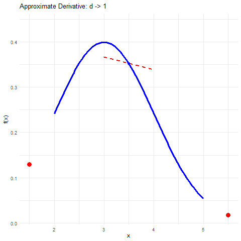
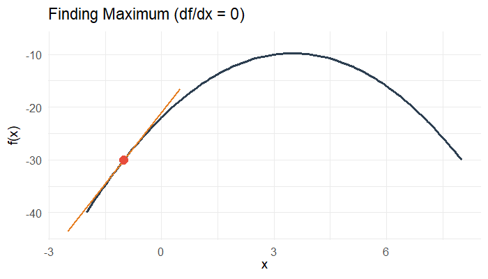

## Derivatives

- Derivatives are core to RTMB and optimization
- A derivative is the the slope (or straight line) that lies tangent to a point on a curve
- Describes the rate of change of the function at that point.

::: {#my-long-container style="height: 400px; border: 1px solid #ccc;"}
{fig-align="center" width="50%"}
:::

```{r}
#| eval: false

library(ggplot2)
library(gganimate)

# Define the function f(x) = x^2 and its derivative at x = 1
f <- function(x) { dnorm(x, 3, 1)  }
df <- function(x, d){(f(x+d) - f(x-d))/(2*d)}
make_line <- function(x, d, x0){
  f0 <- f(x0)
  y = df(x0, d)*(x-x0) + f0
  return(data.frame(x = x, y = y, d = d))
}
x0 <- 3.5
f0 <- f(x0)
x <- seq(x0-0.5, x0+0.5, 0.001)
d <- c(2, 1, 0.5, 0.4, 0.3, 0.2, 0.1, 0.05, 0.01)
out <- do.call("rbind", lapply(d, FUN = function(z){make_line(x, z, x0)}))
out$dval <- out$d
out$d <- as.numeric(factor(out$d, levels = d))

# Build the ggplot
p <- ggplot() +
  # Base function curve
  stat_function(fun = f, color = "blue", linewidth = 1.2, xlim = c(2, 5)) +
  geom_line(data = out, aes(x = x, y = y, group = d), color = "red", linetype = "dashed", linewidth = 1) +
  geom_point(data = out, aes(x = x0, y = f0), color = "blue", size = 2) +
  geom_point(data = out, aes(x = x0 + dval, y = f(x0 + dval)), color = "red", size = 4) +
  geom_point(data = out, aes(x = x0 - dval, y = f(x0 - dval)), color = "red", size = 4) +
  # Labels and title showing current h and slope
  labs(
    title = "Approximate Derivative: d -> {closest_state}",
    x = "x",
    y = "f(x)"
  ) +
  theme_minimal() +
  transition_states(d, transition_length = 1, state_length = 1)
  
animate(p, nframes = 100, fps = 10, 
  renderer = gifski_renderer("derivative_limit.gif"))
```

## Derivatives

- A derivative is the rate of change of a function $f$ with respect to $x$, for some small $\Delta$,

$$
  \frac{df}{dx} \approx \frac{f(x + \Delta) - f(x)}{\Delta}
$$

- Calculus definition is when $\lim_{\Delta \to 0}$

- The maximum/minimum is when the slope is flat, or $\frac{df}{dx} = 0$

## Derivatives

- The derivative changes depending on the value of $x$, 

$$
\begin{aligned}
  f(x) & = 3 - 3x - (x-5)^2\\
  \frac{df}{dx} &= - 3 - 2(x-5)
\end{aligned}
$$

- Optimization is simply finding where the derivative is zero,

$$
\begin{aligned}
    \frac{df}{dx} & = 0\\
    - 3 - 2(x-5) & = 0 \\
    x & = -3/2 + 5 \\
    x & = 3.5
\end{aligned}
$$
- We can do this numerically in R.

```{r}
#| echo: true

max_x <- optimise(f=\(x){3-3*x -(x-5)^2}, maximum = TRUE, interval = c(-10, 10))
max_x$maximum
```

## Derivatives

{fig-align="center" width="75%"}

## Gradient

- Derivative in multiple dimensions (referred to as 'partial derivatives') and $df$ becomes $\partial f$,

$$
  \frac{\partial f(x,y)}{x} = \lim_{\Delta \to 0} \frac{f(x + \Delta, y) - f(x,y)}{\Delta}.
$$

- Gradient is the vector of the partial derivatives,

$$
  \nabla f(x,y) = \Big\{ \frac{\partial f(x,y)}{x}, \frac{\partial f(x,y)}{y} \Big\}
$$

- Minimization/maximization is where gradient is zero (i.e. all partial derivatives are zero)

## Second Derivative

- Second derivatives tell us the rate of change of the derivative.
- Simply the derivative of the derivative $\frac{d^2f}{dx^2}$

$$
  \frac{d^2f}{dx^2} \approx \frac{f(x+\Delta) - 2f(x) + f(x-\Delta)}{\Delta^2}
$$

- Identify inflection point:
  * *Minimum* Positive (Increasing at an increasing rate) 
  * *Maximum* Negative (Increasing at a decreasing rate) 

$$
\begin{aligned}
  f(x) & = 3 - 3x - (x-5)^2\\
  \frac{df}{dx} & = - 3 - 2(x-5)\\
  \frac{d^2f}{dx^2} & = -2
\end{aligned}
$$

- Can tell that this polynomial is 'concave' or faces downward.

- Therefore, we know that when $\frac{df}{dx} = 0$ we have found the maximum!

## Hessian Matrix

- Hessian is matrix of all second partial derivatives

$$
  H_f = \nabla^2 f(x,y) = \begin{bmatrix} 
\frac{\partial^2 f}{\partial x^2} & \frac{\partial^2 f}{\partial x \partial y} \\ 
\frac{\partial^2 f}{\partial y \partial x} & \frac{\partial^2 f}{\partial y^2}
\end{bmatrix}
$$

- Identify inflection point:
  * Positive-definite means *Minimum*
  * Negative-definite means *Maximum*

- Variance is inverse of negative Hessian of log-likelihood.
- If Hessian isn't positive-definite, can't calculate variance.

## Gradients in R

- Finite differences to compute the derivative
- Compute function at nearby points and compute slope (central difference),
$$
  \frac{\partial f}{\partial x} \approx \frac{f(x+\Delta, y) - f(x-\Delta,y)}{2\Delta}.
$$
- Numerical error can be significant
- Computation is slow due to the number of different calls to the function

```{r}
#| echo: true

f <- \(x){
  count <<- count + 1
  3-3*x - (x-5)^2
}
df <- \(x){-3 -2*(x-5)}   ## Derivative

df(0)
count <- 0
pracma::jacobian(f, 0)
cat("Number of times f is called by finite differences:", count, "\n")
```


## RTMB

- Take base R code and pass it to TMB's numerical machinery
- RTMB couples R directly to TMB's automatic- differentiation engine 
- Code in C++ is generally faster than in R
- Automatic Differentiation (AD) is the computation of the 'chain rule' to compute gradients
- Each computation within the tape that doesn't change is pre-computed
- AD gives numerical gradients with analytical precision

## Gradients in RTMB

- Automatic Differentiation starts with 'taping'

```{r}
#| echo: true

library(RTMB)

# f <- \(x){ 3-3*x - (x-5)^2}
fc <- RTMB::MakeTape(f, 0)    ## Evaluates in C++
fc$print()
```

- `inv` (`InvOp`) Independent variable (operator)
- `const` Constant
- `dep` (`DepOp`) Dependent variable (operator)

::: {#my-long-container style="height: 200px; border: 1px solid #ccc;"}
```{r}
#| fig-width: 5
#| fig-height: 4
#| out-width: "100%"

G <- igraph::graph_from_adjacency_matrix(fc$graph())
plot(G, vertex.size = 17, layout = igraph::layout_as_tree)
```
:::


## Gradients in RTMB

- AD is faster and more accurate than finite differences

```{r}
#| echo: true

f <- \(x){3-3*x -(x-5)^2}
df <- \(x){-3 -2*(x-5)}   ## Derivative
d2f <- \(x){-2}           ## Second Derivative

fc <- RTMB::MakeTape(f, 0)    ## Evaluates in C++
dfc <- fc$jacfun()            ## Create a derivative function
d2fc <- dfc$jacfun()          ## Create a derivative of derivative function

pracma::jacobian(f, 0) - dfc(0)
dfc(0) - df(0)

pracma::hessian(f, 0) - d2fc(0)
d2fc(0) - d2f(0)
```

## Ricker Example

- Stock ($s$) specific productivity, carrying capacity, and standard deviation,
$$
  \log(R_i/S_i) = \alpha_{s_i} - \beta_{s_i}S_i + \epsilon_i.
$$

```{r}
#| echo: false
library(ggplot2)
library(dplyr)
sox <- read.csv("../data/sockeye/SRDATA2026 1.csv")
stock <- read.csv("../data/sockeye/FC_StockInfo 2.csv")
sox <- sox %>% left_join(stock, by = "PopID")
sox <- sox %>% filter(!is.na(spawners), !is.na(recruits))
sox <- sox %>% group_by(PopName) %>% mutate(sd_spawners = sd(spawners),  spawners_scaled = spawners/sd_spawners) %>% ungroup()
```

```{r}
#| echo: true

sox$stock <- as.numeric(factor(sox$PopName))
nstocks <- max(sox$stock)
parameters <- list(
  alpha = runif(nstocks, 2, 5),
  logbeta = runif(nstocks, 0, 1),
  logsigma = runif(nstocks, 3, 5)
)

sox$logRS <- log(sox$recruits/sox$spawners)

negll <- function(pars){
  getAll(pars)
  beta <- exp(logbeta)
  sigma <- exp(logsigma)
  mu <- alpha[sox$stock] - beta[sox$stock]*sox$spawners_scaled
  -sum(dnorm(sox$logRS, mu, sigma[sox$stock], log = TRUE))
}
obj <- MakeADFun(func = negll, parameters = parameters, silent = TRUE)
```

## RTMB Speed Up

- Function evaluation

```{r}
#| echo: true

microbenchmark::microbenchmark(
  "R" = negll(parameters),
  "RTMB" = obj$fn(obj$par+rnorm(1,0,0.1)) ## Caches last call so need to perturb
)
```

- Gradient Evaluation

```{r}
#| echo: true

count <- 0
negll_vec <- \(pars){
  params <- obj$env$parList(pars)
  count <<- count + 1
  negll(params)
}
gr <- pracma::jacobian(negll_vec, obj$par)
print(count)

microbenchmark::microbenchmark(
  "R" = pracma::jacobian(negll_vec, obj$par),
  "RTMB" = obj$gr(obj$par + rnorm(1, 0, 0.1)),
  times = 10
)
```

## RTMB Hessian

- Finite differences approximate the gradient by evaluating function nearby and computing slope.
- Requires multiple function evaluations for each parameter
- Hessian requires even more evaluations with additional numerical error
- Accurate and fast Hessian required for standard errors
- Hessian critical to marginalize random effects (discuss later)

```{r}
#| echo: true

count <- 0
gr <- pracma::hessian(negll_vec, obj$par)
print(count)
```

## Practical

- Make sure your Ricker model gradient is computing correctly.
- Compare your versions with `RTMB` and `R`
- Try comparing AD gradient `obj$gr` with finite differences `pracma::jacobian`
- Try comparing AD Hessian `obj$he` with finite differences `pracma::hessian`


## Optimization in R

- Random start, evaluate objective function, use gradient to move to new value
- Run until at maximum/minimum (where gradient is zero)
- Newton based functions to use `optim` or `nlminb`
- If gradient not provided, then finite differences are used.

```{r}
#| echo:true

set.seed(24)
x <- rnorm(100, 0.25, 2)
nll <- \(pars){
  mu <- pars[1]
  sigma <- exp(pars[2])
  -sum(dnorm(x, mu, sigma, log = TRUE))
}

# optim(c(0,0), nll)
nlminb(c(0,0), nll)
```

## Optimization in R

:::: {.columns style="display: flex; align-items: center;"}

::: {.column width="40%"}
- What about more than one peak? (Multimodality)
- Derivative is zero at more than one place
- Want 'global' maximum
- Random starting points are critical
- If likelihood is multimodal there are likely other things wrong
- As we get more data, the likelihood becomes more smooth and 'peaky'

:::

::: {.column width="60%"}
```{r}
#| fig-width: 7
#| fig-height: 5.5
#| out-width: "100%"
#| fig-align: "center"
#| echo: false
#| 
set.seed(42)
x <- c(rnorm(30, 2, 1), rnorm(30, 7, 1))
negloglik <- \(mu){
  -sum(log(0.5*dnorm(x, mu, 1) + 0.5*dnorm(x, 3, 3)))
}
mu <- seq(-2, 12, by = 0.05)
ll <- -sapply(mu, negloglik)

plot(mu, ll, type = 'l', xlab = "mu", ylab = "Log-Likelihood L(mu|x)")
grid()
est1 <- nlminb(0, negloglik)
points(c(0, est1$par), c(-negloglik(0), -est1$obj), col = 'red', pch = c(1, 4), cex = 1.5)
lines(c(0, est1$par), c(-negloglik(0), -est1$obj), col = 'red', lty = 2,lwd = 2)
est2 <- nlminb(10, negloglik)
points(c(10, est2$par), c(-negloglik(10), -est2$obj), col = 'red', pch = c(1, 4), cex = 1.5)
lines(c(10, est2$par), c(-negloglik(10), -est2$obj), col = 'red', lty = 2, lwd = 2)
```
:::

::::


## Fitting the MLE

::: {#my-long-container style="height: 200px; border: 1px solid #ccc;"}
```{r}
#| out-width: "65%"
#| echo: true
#| fig-align: "center"

par_init <- obj$par + rnorm(length(obj$par))
mle <- nlminb(obj$par, obj$fn, obj$gr)
plot(t(obj$gr(mle$par)), ylab = "gr", xlab = "index")
abline(h = 0, col = 'red', lty = 2)
```
:::

## End of Module

- Take home: 
  * Gradient is critical for optimization
  * Need Hessian to check optimization and compute variance
  * RTMB makes it really easy and fast to compute gradients
- Questions?
